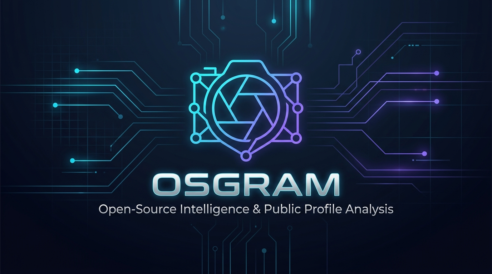
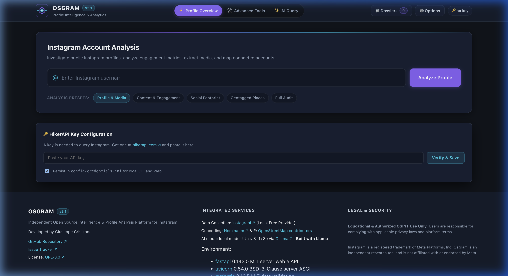
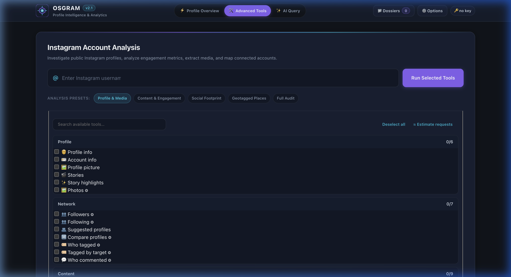
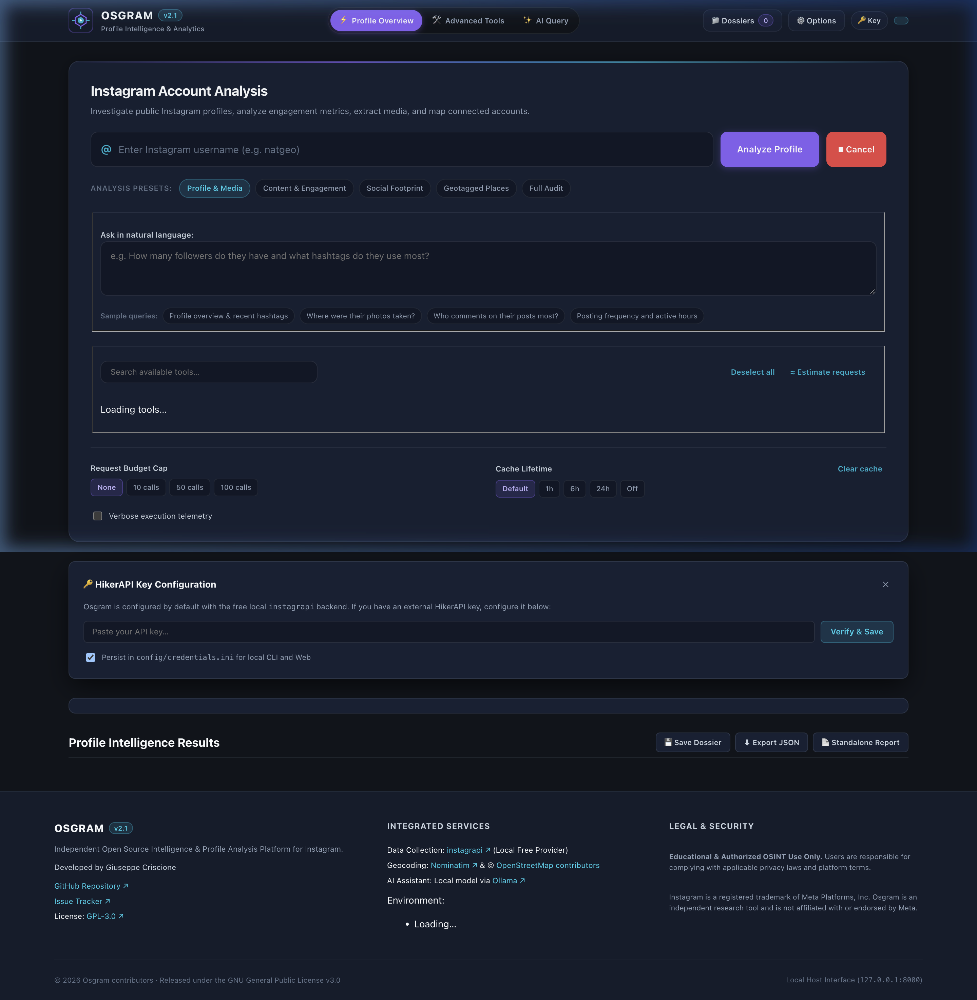

# Osgram

<p align="center">
  
</p>

<p align="center">
  <strong>Open-source intelligence (OSINT) and public profile analysis suite for Instagram.</strong><br>
  Maintained by <strong><a href="https://github.com/fakhryaiman7">FakhryAiman</a></strong>.
</p>

<p align="center">
  <a href="doc/CHANGELOG.md"></a>
  <a href="LICENSE"></a>
  <a href="https://www.python.org/"></a>
  <a href="#overview"></a>
  <a href="https://github.com/fakhryaiman7"></a>
</p>

---

## Overview

**Osgram** is a modular, local-first OSINT investigation platform designed for reconnaissance and forensic analysis of public Instagram accounts. It extracts, cross-references, and organizes public metadata—including followers, followings, engagement patterns, caption linguistics, hashtags, geotagged coordinates, and contact details—into a modern, dark-themed dashboard as well as a scriptable terminal CLI.

Unlike legacy scripts that dump raw, unformatted text or rely on expensive third-party cloud subscriptions, Osgram operates **100% locally on your machine** (`127.0.0.1`), utilizes a decoupled provider architecture (supporting direct Instagram sessions via `instagrapi` and offline synthetic testing via `mock`), caches queries in an internal SQLite database, and offers historical dossier comparisons.

---

## Features

- **Intuitive Web Dashboard**: Clean dark-mode single-page interface with real-time feedback, reactive status logs, and responsive layout.
- **Profile Overview & Deep Analytics**: Displays full HD avatar previews, verified/business/privacy flags, follower/following ratios, biography with extracted hyperlinks, and public contact signals (email, phone, address).
- **28 Modular OSINT Capabilities**:
  - **Profile Intelligence**: Account metadata, story highlights, user photos, and full-resolution profile images.
  - **Network & Social Graph**: Followers, followings, mutual connections comparison (`compare_with`), tagged users, and frequent commenters.
  - **Content & Behavioral Metrics**: Top hashtags, caption texts, total like/comment counts, media type distributions, and photo descriptions.
  - **Temporal & Geospatial Intelligence**: Visual weekday × hour posting heatmaps and interactive Leaflet/OpenStreetMap coordinate mapping for tagged locations.
  - **Target-Free Reconnaissance**: Query public posts by specific hashtags (`search_hashtag`) or geographic locations (`search_location`).
- **Provider Architecture**:
  - **`instagrapi`**: Free, direct Instagram connection leveraging persistent session files.
  - **`mock`**: Deterministic offline provider for unit testing, CI pipelines, and demo environments without touching Instagram networks.
- **Dossier System & Historical Diffs**: Save snapshot dossiers of profiles over time and perform instant differential audits ("What Changed") to spot follower count drops, renamed handles, bio edits, and deleted posts.
- **Local Request Caching**: SQLite-backed request cache (`cache/requests.sqlite3`) preventing duplicate upstream requests and rate-limiting triggers.
- **Data & Media Exporter**: Instant single-click export of structured intelligence to formatted JSON, Excel-safe CSV tables, and bundled ZIP archives of original media.

---

## Screenshots

<p align="center">
  
  <br>
  <em>Figure 1: Osgram Profile Overview with identity metrics, formatted biography, and quick presets.</em>
</p>

<p align="center">
  
  <br>
  <em>Figure 2: Advanced Tools command picker grouped by investigation domain with parameter controls.</em>
</p>

<p align="center">
  
  <br>
  <em>Figure 3: Interactive analysis results featuring media previews, hashtag rankings, and export utilities.</em>
</p>

---

## Requirements

| Component | Requirement | Details |
|---|---|---|
| **Operating System** | Linux, macOS, or Windows (WSL recommended) | Cross-platform |
| **Python** | 3.10 or higher | Verified up to Python 3.14 |
| **Browser** | Chrome, Firefox, Safari, or Edge | For the web interface |
| **Network** | Outbound HTTPS | Direct connection to Instagram endpoints (not required in `mock` mode) |
| **Account** | Secondary / Burner Instagram Account | Recommended for `instagrapi` provider |

---

## Installation

### Standard Installation

1. **Clone the repository:**
   ```bash
   git clone https://github.com/fakhryaiman7/osgram.git
   cd osgram
   ```

2. **Create and activate a virtual environment:**
   ```bash
   python3 -m venv .venv
   source .venv/bin/activate  # On Windows: .venv\Scripts\activate
   ```

3. **Install dependencies:**
   ```bash
   pip install --upgrade pip
   pip install -r requirements.txt
   ```

### Docker Installation

You can also run Osgram in an isolated Docker container:

```bash
docker compose up --build
```

The web dashboard will be exposed locally on `http://127.0.0.1:8000`. Credentials and cache directories (`config/`, `cache/`, `dossier/`) are mounted from the host.

---

## Configuration

1. **Initialize the credentials file:**
   ```bash
   cp config/credentials.ini.example config/credentials.ini
   nano config/credentials.ini
   ```

2. **Set up Instagram authentication (`instagrapi` provider):**
   Configure your credentials inside `config/credentials.ini` using `nano`:
   ```ini
   [Credentials]
   username = your_secondary_username
   password = your_secondary_password
   ```

3. **Generate a persistent session (Recommended):**
   To handle two-factor authentication (2FA) or challenge prompts cleanly, run the interactive login script once from your terminal:
   ```bash
   python scripts/instagrapi_login.py
   ```
   This generates `config/instagrapi_session.json`. Future runs will authenticate automatically using this session token without re-entering credentials.

Alternatively, credentials can be supplied via environment variables:
```bash
export INSTAGRAM_USERNAME="your_username"
export INSTAGRAM_PASSWORD="your_password"
```

---

## Usage

### 1. Web Dashboard (Recommended)

Start the local web application:

```bash
uvicorn src.web.app:app --host 127.0.0.1 --port 8000 --reload
# Or using Makefile shortcut:
make run
```

Open your browser and navigate to:
```
http://127.0.0.1:8000
```

- **Quick Mode (Profile Overview)**: Enter a target username and select an investigation preset (Overview, Engagement, Network, Geotags, or Full Scan).
- **Advanced Tools**: Select specific tools from the grouped picker, customize parameters (e.g., scan limits), and review real-time execution steps.

For complete documentation on web features, see [`doc/web-ui.md`](doc/web-ui.md).

### 2. Interactive Terminal CLI

Osgram also retains a terminal interface for headless environments:

```bash
python3 main.py <target_username>
```

Type `list` to view available commands, or execute functions directly:
```text
Run a code: get_user_info
Run a code: get_hashtags
Run a code: get_posting_times
```

---

## Providers

Osgram utilizes a clean factory pattern (`src/providers/`) to separate data acquisition from analysis logic:

```
                  ┌────────────────────────┐
                  │    OsintgramService    │
                  └───────────┬────────────┘
                              │
                  ┌───────────▼────────────┐
                  │   InstagramProvider    │
                  │      (Base Interface)  │
                  └─────┬────────────┬─────┘
                        │            │
         ┌──────────────▼─────┐ ┌────▼───────────────┐
         │ InstagrapiProvider │ │    MockProvider    │
         │   (Live Session)   │ │  (Offline Fixtures)│
         └────────────────────┘ └────────────────────┘
```

1. **`instagrapi` (Default Live Provider)**:
   - Connects directly to public Instagram endpoints via an active session.
   - 100% free and self-hosted—no third-party data broker subscription required.
   - Force via: `export INSTAGRAM_BACKEND=instagrapi`.

2. **`mock` (Offline Testing Provider)**:
   - Uses local synthetic fixtures for testing, development, and demonstrations.
   - Requires no credentials, network connectivity, or API tokens.
   - Force via: `export INSTAGRAM_BACKEND=mock`.

---

## Troubleshooting

- **Login Checkpoint / Challenge**:
  If Instagram requests email/SMS verification, run `python scripts/instagrapi_login.py` in your terminal to complete the interactive challenge and store the session.
- **Session Expired (`LoginRequired`)**:
  Delete `config/instagrapi_session.json` and re-run `python scripts/instagrapi_login.py` to refresh the session.
- **Rate Limits (`429 Too Many Requests`)**:
  Osgram automatically caches responses in `cache/requests.sqlite3`. Avoid scanning thousands of accounts rapidly with a new burner account; adjust scan limits using the UI options.
- **Port Conflict**:
  If port `8000` is occupied, specify an alternate port:
  ```bash
  uvicorn src.web.app:app --host 127.0.0.1 --port 8080
  ```

---

## Roadmap

- [ ] Automated network relationship graph visualization (interactive node charts).
- [ ] Export directly to structured PDF and forensic Markdown dossier reports.
- [ ] Multi-account simultaneous tracking and comparison matrices.
- [ ] Configurable proxy support (HTTP/SOCKS5) per provider session.

---

## Credits

Osgram builds upon the foundation of **Osintgram**, originally authored by **Giuseppe Criscione** ([Datalux](https://github.com/Datalux)).

### Major Modifications & Enhancements by FakhryAiman:
- **Architecture Refactoring**: Rebuilt the monolithic architecture into a clean, decoupled provider abstraction layer (`src/providers/`).
- **Free, Self-Hosted Engine**: Completely decoupled the application from paid third-party API dependencies (such as HikerAPI), replacing it with resilient `instagrapi` session management and synthetic `mock` providers.
- **Modern Web Dashboard**: Designed and implemented a responsive, dark-mode analytical web dashboard with interactive Leaflet maps, posting heatmaps, and live progress streaming.
- **Dossier & Differential Engine**: Introduced the dossier snapshot system allowing researchers to audit profile evolution over time.
- **Performance & Caching**: Engineered SQLite-backed localized request caching and export tools (JSON, CSV, ZIP).

---

## License & Disclaimer

This project is licensed under the **GNU General Public License v3.0 (GPL-3.0)**. See the [LICENSE](LICENSE) file for complete details.

### Legal Disclaimer
**FOR EDUCATIONAL AND DEFENSIVE OSINT RESEARCH ONLY.**
This tool is intended strictly for authorized security assessments, digital forensics, and personal privacy auditing of publicly available information. The maintainers assume no liability for misuse, policy violations, or damages resulting from the use of this software. Always adhere to applicable local laws, regulations (such as GDPR), and Instagram's Terms of Service.

*Instagram is a registered trademark of Meta Platforms, Inc. Osgram is an independent research project and is not affiliated with, sponsored by, or endorsed by Meta Platforms, Inc.*
